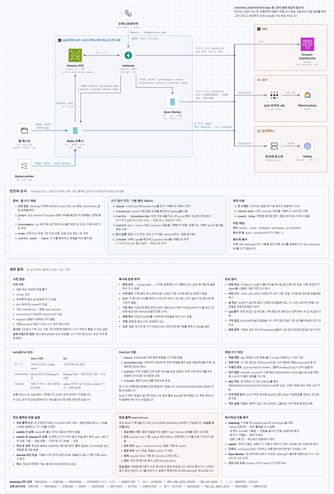

<picture>
  <source media="(prefers-color-scheme: dark)" srcset="docs/architecture-dark.png">
  
</picture>

[구조도 HTML 원본](docs/architecture.html)

# redis-migrator

Redis를 AWS, GCP, 온프레미스 사이에서 이전한다. 앱은 프록시 주소만 알고, 전환할 때 쓰기를 잠깐 멈춘 뒤 프록시가 대상 Redis를 바꾼다.

```text
앱 → Redis 프록시 → ElastiCache / Memorystore / 온프레 Valkey
           ↑                     ↑
       statemig  →  Sync Worker (양쪽 동기화)
```

| 구성 요소 | 코드 | 포트 | 역할 |
|---|---|---|---|
| Redis 프록시 (Go) | `proxy/cmd/proxy` | RESP `6379`, 관리 `7000` | 앱의 고정 주소. PAUSE, SWITCH, RESUME |
| Sync Worker (Go) | `proxy/cmd/syncworker` | 관리 `7100` | keyspace 알림과 스캔으로 복사, 역방향 동기화, 버킷 해시와 값 비교 |
| statemig (FastAPI) | `statemig/` | `8090` | 전환·롤백 단계 실행. 오케스트레이터가 호출 |

## 지원 범위

- 옮기는 키: `session:`, `cache:`, `q:delayed`, 실패 큐 `q:join:dead`, `q:notify:dead`. `rl:`은 옮기지 않는다
- 작업 큐 `q:join`, `q:notify`는 복사하지 않고, 원본을 다 소비한 뒤 소비자를 옮긴다
- Pub/Sub 구독(`SUBSCRIBE`, `PSUBSCRIBE`)은 전환해도 연결이 유지된다. 정상 전환과 정상 롤백에서는 메시지 유실·중복이 없다. `MONITOR`와 `SSUBSCRIBE`는 끊는다
- 여러 db는 번호 그대로 옮긴다
- 사전 점검에서 거부: Cluster 모드, 반대쪽에 없는 db 번호, db 0 밖의 큐, `maxmemory`가 있는데 `noeviction`이 아닌 경우, 원본에 앱의 직접 연결이 남은 경우
- 평소 앱이 Redis에 직접 붙는 구성(설계 3-8): 오케스트레이터가 앱을 프록시로 옮긴 뒤 PREPARE를 보낸다. 사전 점검은 원본 `CLIENT LIST`에서 이름이 `direct:`로 시작하는 연결과, 이름 없이 `STATEMIG_DIRECT_USER`로 붙은 연결을 센다. 프록시는 `statemig-proxy`, Sync Worker와 statemig는 `statemig-admin`으로 이름을 붙인다. 통과하면 원본의 직접 연결 계정을 끄고, 이전이 끝나면(확정, 취소, 복귀 후 FINALIZE) 남은 쪽의 계정을 켠다. ACL이 막힌 관리형 Redis에서는 상태에 `direct_fence: manual`로 표시하고, 계정 교체는 제공자 쪽에서 한다

관리형 Redis는 CONFIG가 막혀 있으므로 keyspace 알림(`KEA`)과 `maxmemory-policy noeviction`을 파라미터 그룹이나 인스턴스 설정으로 켜 둬야 한다. ACL도 막혀 있어서 원본 쓰기 차단은 자격 증명 분리로만 동작한다.

전체 비교와 구독이 끊긴 뒤의 재비교는 Redis 안에서 Lua로 해시를 만들어 비교한다. Lua를 쓸 수 없으면 전체 비교는 값 비교로, 재비교는 전체 복사 뒤 값 비교로 대체한다.

## 공통 API

오케스트레이터가 호출하는 API다. [마이그레이션 공통 Design Doc](https://app.notion.com/p/40d8bee9ada4815e9e94ee454be82d4a) 초안 0.2의 형식을 따른다. `:8090`에서 제공하며 `Authorization: Bearer <STATEMIG_ADMIN_TOKEN>`이 필요하다. POST에는 `Idempotency-Key`도 필요하다.

| 메서드 | 경로 | 동작 |
|---|---|---|
| GET | `/v1/capabilities` | 지원 프로필과 제약 |
| POST | `/v1/migrations` | 계획 등록. 외부 변경 없음 |
| GET | `/v1/migrations/{id}` | 현재 상태와 진행 판정 |
| POST | `/v1/migrations/{id}/actions` | 명령 접수. `202`와 `operationId` |
| GET | `/v1/operations/{id}` | 명령 결과 |

```json
{"workflowId":"wf-001","resourceId":"redis-main","kind":"REDIS","profile":"redis-proxy-sync-v1",
 "sourceRef":"resource:aws","targetRef":"resource:gcp","bindingRef":"binding:redis-proxy",
 "workloadScopeRef":"workload:groupbuy-app",
 "policy":{"rollbackMode":"REVERSE_REQUIRED","maxQuiesceSeconds":1.8,"readyTimeoutSeconds":600}}
```

```json
{"action":"CUTOVER","expectedRevision":8,"transitionId":"tx-001","quiesceRef":"quiesce:redis-main:tx-001:1"}
```

| 명령 | Redis에서 하는 일 |
|---|---|
| `PREPARE` | 사전 점검 |
| `START_SYNC` | 복사와 변경 추적 시작. `readyTimeoutSeconds`까지 `READY`가 안 되면 취소 |
| `QUIESCE` | **확인만 한다.** `ready`와 키 수. 쓰기는 멈추지 않는다 |
| `CUTOVER` | **쓰기 정지, 전환, 재개까지 한 번에.** `maxQuiesceSeconds`가 쓰기 정지 예산 |
| `RESUME` | **이미 재개된 위치를 확인만 한다.** `expectedLocation`은 `TARGET` 또는 `SOURCE` |
| `ROLLBACK` | 원본 복귀, 재개까지 포함. `"mode":"failure"`는 대상 장애 시의 유실 감수 복귀 |
| `CANCEL` | 컷오버 전 취소. 대상 데이터는 남긴다 |
| `RECONCILE` | 기록과 실제 상태 대조. 외부 변경 없음 |
| `FINALIZE` | 역방향 또는 정방향 동기화 중지. 원본은 지우지 않는다 |

```text
CREATED → PREPARED → SYNCING ↔ READY → QUIESCED → SWITCHED → ACTIVE → COMPLETED
ACTIVE → QUIESCED → ROLLED_BACK_HELD → RESTORED → COMPLETED
```

| 응답 | 코드 |
|---|---|
| `400` | `INVALID_REQUEST`: 필수 값 누락 |
| `401` | 토큰 없음 |
| `404` | `NOT_FOUND` |
| `409` | `REVISION_CONFLICT`, `IDEMPOTENCY_CONFLICT`, `RESOURCE_BUSY`, `INVALID_STATE`, `UNKNOWN_STATE` |
| `422` | `UNSUPPORTED_PROFILE`, `PRECONDITION_FAILED` |

### 공통 문서와 다른 점

전환 동작은 팀 합의 전까지 바꾸지 않았다.

- `QUIESCE`와 `RESUME`은 확인만 한다. 쓰기 정지와 재개는 `CUTOVER`, `ROLLBACK` 안에서 한다.
- `ROLLBACK`의 `mode=failure`는 대상 장애 때 유실을 감수하고 원본으로 돌아간다. 공통 문서는 이 복귀를 금지한다.
- 어댑터가 1초마다 스스로 복구한다. 그 결과는 상태 조회에 드러나지만 `UNKNOWN`에서 멈춰 기다리지는 않는다. 어댑터가 명령 도중 재시작한 경우에만 그 명령이 `UNKNOWN`이 되어 `RECONCILE`을 요구한다.
- 쓰기 정지 예산을 넘으면 전환 전에 취소하고 원본에서 재개한다.

아직 구현하지 않은 것:

- `quiesceRef`는 값이 있는지만 본다. 검증하려면 공유 관리 DB가 필요하다.
- `readiness.advance`는 `PASS`가 되지 않는다. `WORKLOAD_RUNNING`, `BUSINESS_PROBE`는 오케스트레이터의 근거가 필요해 `UNKNOWN`이다.
- 계획과 명령 기록은 관리 DB 대신 `common.json`에 저장한다. 검사 근거는 저장하지 않고 조회 때 계산한다.
- `sourceRef`는 `resource:<STATEMIG_ENDPOINTS의 이름>` 형식이다. 비밀 저장소 참조는 없다.

## 내부 API

공통 API 아래에서 쓰는 API다. 모두 같은 토큰이 필요하다.

| 서비스 | 경로 |
|---|---|
| statemig | `POST /migrations`, `GET /migrations/current/ready`, `POST /migrations/current/{cutover,rollback,commit}`, `GET /status`, `/internal/{prepare,execute,rollback,commit,abort,status}` |
| 프록시 | `GET /status`, `POST /pause`, `POST /presubscribe`, `POST /switch`, `POST /resume`, `POST /drain-done` |
| Sync Worker | `GET /status`, `POST /start`, `POST /precompare`, `POST /reconcile`, `POST /verify`, `POST /warm`, `POST /reverse`, `POST /stop` |

## 배포 위치

프록시, Sync Worker, statemig는 AWS 관리 VPC에 둔다. 프록시와 statemig는 `control.json`을 공유하므로 같은 파일 시스템을 마운트한다(ECS에서는 EFS, 아래 참고).

환경 간 연결은 Tailscale로 한다. ElastiCache와 Memorystore에는 Tailscale을 설치할 수 없어서 각 VPC의 라우터나 피어링을 거친다.

## ECS 배포

앱 태스크는 몇 개든 된다. 모두 같은 프록시 주소에 붙으면 된다. 프록시를 앱마다 사이드카로 붙이면 프록시가 여러 대가 되어 지원하지 않는다.

### 이미지

| 이미지 | 빌드 | 실행 |
| --- | --- | --- |
| Go (프록시, Sync Worker) | `docker build -t statemig-go proxy/` | 프록시: 기본 entrypoint `statemig-proxy`. Sync Worker: entrypoint를 `statemig-syncworker`로 |
| statemig | `docker build -t statemig .` | command `uvicorn statemig.api:app --host 0.0.0.0 --port 8090 --timeout-keep-alive 120` |

### 서비스

세 서비스 모두 태스크 1개로 고정한다. 둘이 동시에 뜨면 같은 마이그레이션을 두 곳에서 진행하므로, 배포 설정은 `minimumHealthyPercent=0`, `maximumPercent=100`으로 둔다(옛 태스크를 내린 뒤 새 태스크를 띄움). 오토스케일링은 붙이지 않는다. 마이그레이션 중에는 이 세 서비스를 배포하지 않는다.

| 서비스 | 포트 | 여는 대상 | `/state` |
| --- | --- | --- | --- |
| proxy | 6379 (앱 연결), 7000 (관리) | 6379: 앱 태스크. 7000: statemig | EFS |
| syncworker | 7100 (관리) | statemig | 없음 |
| statemig | 8090 (API) | 컨트롤 플레인 | EFS |

앱은 프록시를 고정 이름으로 찾는다(Cloud Map 또는 내부 DNS, 예: `redis-proxy.internal:6379`). statemig는 프록시와 Sync Worker를 같은 방식으로 찾는다.

### EFS

statemig와 proxy가 같은 EFS 접근 지점을 `/state`로 마운트한다. 들어가는 파일은 전환 기록 `control.json`과 진행 상태 `migration.json`, `common.json`이다(수 KB).

statemig가 태스크 교체로 이 파일을 잃으면 컷오버를 한 적이 없다고 보고 프록시를 원본으로 되돌린다. 그래서 태스크 로컬 디스크에 두면 안 된다. 파일은 임시 파일에 쓰고 rename으로 교체한다. 보안 그룹에서 두 서비스 → EFS의 NFS(2049)를 연다.

### 환경 변수

`[비밀]`은 Secrets Manager에서 넣는다. 엔드포인트 이름(`aws`, `gcp`, `onprem` 등)은 세 서비스에서 같아야 한다. TLS가 켜진 Redis는 `rediss://`로 쓴다.

| 변수 | proxy | syncworker | statemig |
| --- | --- | --- | --- |
| `STATEMIG_ENDPOINTS` [비밀] | `aws=redis://app:<앱 계정 pw>@<원본>:6379,gcp=redis://app:<pw>@<대상>:6379`. 앱 계정 | `aws=redis://default:<관리자 pw>@...,gcp=...`. 관리자 계정 | syncworker와 같음 |
| `STATEMIG_ADMIN_TOKEN` [비밀] | 같은 값 | 같은 값 | 같은 값 |
| `STATEMIG_CONTROL_FILE` | `/state/control.json` | | `/state/control.json` |
| `STATEMIG_ACTIVE` | 처음 쓸 Redis 이름 (예: `aws`). 기록이 없을 때만 씀 | | |
| `STATEMIG_CLIENTS` [비밀] | 앱이 프록시에 AUTH할 계정. `app:<pw>:app,worker:<pw>:worker` | | |
| `STATEMIG_PROXY` | | | `http://redis-proxy.internal:7000` |
| `STATEMIG_SYNCWORKER` | | | `http://redis-syncworker.internal:7100` |
| `STATEMIG_APP_USER` | | | 앱 계정 이름 (기본 `app`). 원본 쓰기 차단에 씀 |
| `STATEMIG_DIRECT_USER` | | | 앱이 평소 Redis에 직접 붙는 계정 (선택). `STATEMIG_APP_USER`와 달라야 함. 사전 점검의 직접 연결 판정과 원본 계정 끄기에 씀 |

앱은 프록시 주소와 `STATEMIG_CLIENTS`의 계정으로 붙는다. Redis 비밀번호는 프록시만 안다.

### 헬스체크

모든 API가 관리 토큰을 요구하므로 컨테이너 안에서 토큰을 붙여 `GET /status`를 부른다.

```bash
# proxy (7000), syncworker (7100): alpine 이미지의 wget
wget -q -O /dev/null --header "Authorization: Bearer $STATEMIG_ADMIN_TOKEN" http://127.0.0.1:7000/status
```

```bash
# statemig: python 이미지
python -c "import os,urllib.request as u;u.urlopen(u.Request('http://127.0.0.1:8090/status',headers={'Authorization':'Bearer '+os.environ['STATEMIG_ADMIN_TOKEN']}),timeout=3)"
```

### 망

프록시와 Sync Worker는 원본과 대상 Redis에 직접 닿아야 한다. AWS ECS에서 GCP Memorystore로 가는 경로(Tailscale 서브넷 라우터, VPN)는 인프라에서 연다. 왕복 시간이 쓰기 정지 시간을 정한다(30ms 기준 약 150ms).

## 실행

```bash
cd demo && docker compose up -d --build
```

로컬 관리 토큰은 `demo-admin-token`이고, statemig는 `localhost:18090`이다.

## 검사

스택을 띄우고 호스트에서 실행한다. `httpx`와 `redis`가 필요하다.

| 명령 | 확인 내용 |
|---|---|
| `python demo/adapter_check.py` | 공통 API의 전체 명령, 재시도, 거부 |
| `python demo/scenario.py --mode normal` | 부하 중 컷오버, 롤백, commit |
| `python demo/scenario.py --mode failure` | 대상 Redis 강제 종료 후 롤백 |
| `python demo/faults.py` | 실패 경로와 권한 제한 |
| `python demo/recovery_check.py` | Redis가 빈 채로 재시작, 프록시·Sync Worker·statemig가 전환 도중 사망 |
| `python demo/onprem_check.py` | 온프레 Valkey 전환과 롤백 |
| `python demo/chain_check.py` | aws → 온프레 → gcp 연속 이전 |
| `python demo/multidb_check.py` | 여러 db의 번호 유지, 실패 큐 |
| `python demo/topology_check.py` | 사전 점검의 거부 조건 (자체 컨테이너) |
| `python demo/direct_check.py` | 직접 연결이 남은 원본 거부, 원본 직접 연결 계정 끄기와 남은 쪽 켜기 (자체 컨테이너) |
| `python demo/loss_report_check.py` | 장애 롤백의 유실 범위 보고 |
| `python demo/pubsub_check.py` | 전환 중 구독 유지, 메시지 유실·중복 |
| `sudo python demo/syn_loss_check.py` | SYN이 유실돼도 장애 롤백의 쓰기 정지가 1초 미만 (root, iptables) |
| `cd proxy && go test ./...` | 멈춘 구독자, 구독 연결의 명령 제한, 파이프라인 전달, 경로 변경 시 재전송, 버킷 비교, 만료 시각 계산 |
| `python demo/aws_check.py` | 실제 ElastiCache. 같은 VPC의 호스트에서 실행 |

`demo/app`은 검사에서 부하를 거는 앱이다. 실제 공구앱은 [demo 레포](https://github.com/SoftBank-2026-Hackathon-Foxtrot/demo)에 있다.

## 실환경 검증 (2026-11-03)

ElastiCache for Valkey 8.0, Memorystore for Redis 7.2, 온프레 Valkey 8.0을 Tailscale로 잇고 부하 중에 옮겼다. 상세는 [검증 결과](https://app.notion.com/p/40d8bee9ada48102a0ccfb62720fe22f)에 있다.

- 컷오버, 정상 롤백, 연속 이전: 쓰기 정지 210~676ms. 채팅(Pub/Sub) 유실·중복, WebSocket 끊김, 로그인 실패 모두 0건
- Valkey 8.0과 Redis 7.2 사이의 `DUMP`/`RESTORE`는 양방향으로 동작했다
- 장애 롤백: 쓰기 정지 0.5~4.1초. 4.1초는 쓰기 정지 안에서 새 연결을 열다 SYN이 유실돼 커널 재시도(1초, 3초)를 기다린 것이다. 로컬에서 같은 4.1초를 재현했고, 연결을 정지 전에 열어 두고 새 연결은 0.3초 만에 재시도하도록 고쳐 57~329ms가 됐다. 11월 4일 실환경에서 다시 재서 318~334ms였다
- 구간별 1~2회, 키 7600개, 구독 3개 이하 규모다. DB·오브젝트·트래픽 계층과의 통합과 오케스트레이터는 포함하지 않았다

## 실환경 재현 (2026-11-04)

`4e06fa3`을 ElastiCache for Valkey 8.0.1과 Memorystore for Redis 7.2.4에 올려 시험했다. 온프레는 포함하지 않았다. 조건과 수치는 [재현 결과](https://app.notion.com/p/40e8bee9ada481e3ba7afffb42227472)에 있다.

- 버킷 비교(Lua)는 두 제품 모두에서 동작했다
- 컷오버와 정상 롤백: 쓰기 정지 46~61ms. 키 30만 개에서도 61ms, 요청 실패와 세션 유실 0건
- 네트워크 단절 후 장애 롤백 4회: 쓰기 정지 318~334ms, 롤백 후 요청 실패가 회차마다 1건
- 대상 구간을 15초 끊으면 키 10개의 TTL이 최대 약 27초 길어졌다

뒤의 두 문제를 `e90b7e1`, `cc948e0`에서 고쳤다. TTL은 로컬에서 같은 단절을 재현해 어긋남이 없어진 것을 확인했다. 롤백 후 요청 실패는 로컬에서 재현되지 않아 단위 테스트로만 확인했다. 둘 다 실환경 재측정은 하지 않았다.

## 아직 안 된 것

- 오케스트레이터 연결
- 공통 스펙 확정 후 API 조정
- `e90b7e1`, `cc948e0`의 실환경 재측정

구현이 설계와 다른 점은 [DESIGN.md](DESIGN.md), 온프레 구성은 [onprem/README.md](onprem/README.md)에 있다.
